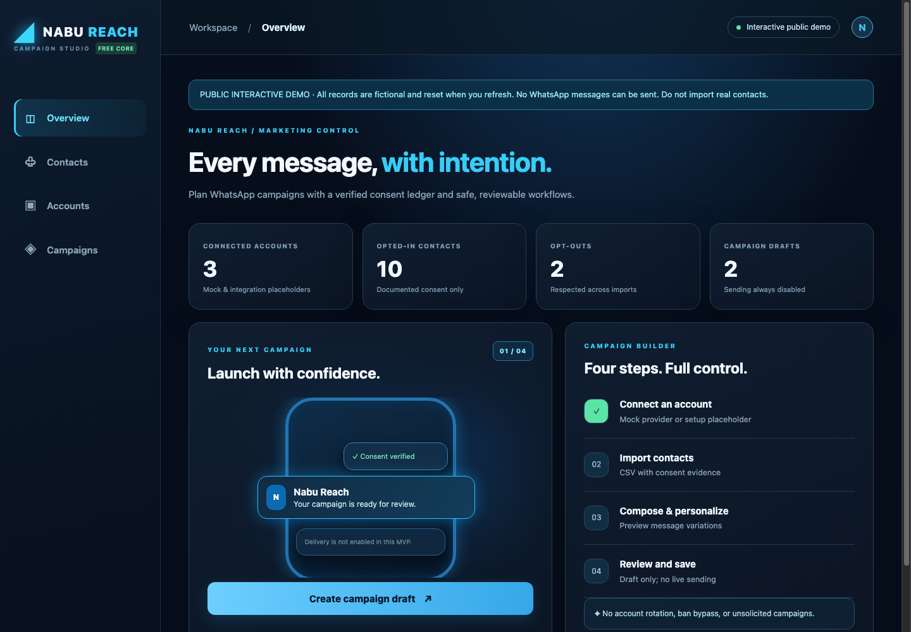
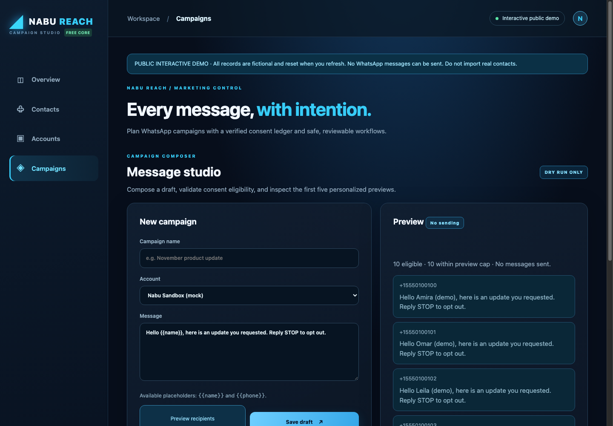
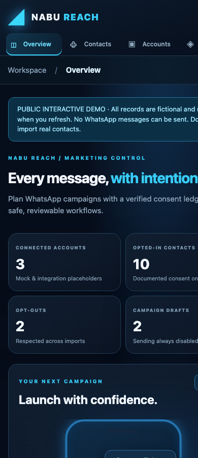
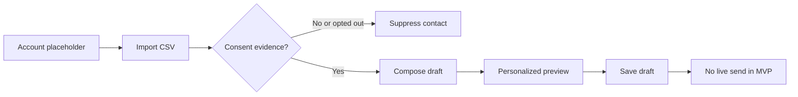
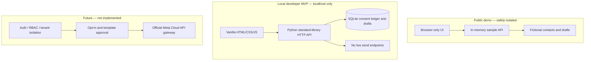

<div align="center">

# ◢ NABU REACH

### WhatsApp Campaign Studio — every message, with intention.

**A beautiful, self-hostable foundation for consent-first outreach, account organization, campaign drafts, and safe previews.**

[](LICENSE)
[](LICENSE)
[](docs/SECURITY.md)

**[Live interactive demo](https://reach.nabuxai.com)** · [Quick start](#quick-start) · [Architecture](#architecture) · [Roadmap](#roadmap)

</div>

> [!IMPORTANT]
> **This release is a draft-only proof of concept.** The public website is an interactive **static simulation**: fictional contacts, no backend database, no credentials, no WhatsApp messages and no network API calls. Edits remain in your browser memory and reset on refresh. Do **not** upload real contact data to a public demo. The separate Python MVP below is **localhost-only** and has **no authentication**.

## ✨ Product tour

#### 01 — Command center
A quiet navy/cyan workspace for managing account placeholders, verified consent, and draft activity.



#### 02 — Message studio
Preview personalized messages against fictional, opted-in recipients. There is intentionally **no Send button**.



#### 03 — Responsive by default
Built for comfortable operation on desktop and compact screens.

<p align="center"></p>

## What you can use today

| Feature | Local MVP | Live static demo |
| :-- | :--: | :--: |
| Dark, responsive dashboard | ✅ | ✅ |
| Multiple account records | ✅ | ✅ Simulated |
| Three-path WhatsApp connection guide (QR, Coexistence, WABA) | ✅ UI-only | ✅ UI-only · no pairing |
| CSV contact import + opt-in evidence | ✅ SQLite | ✅ Browser memory |
| Persistent opt-out suppression on re-import | ✅ | ✅ Within session |
| Personalization with `{{name}}` and `{{phone}}` | ✅ | ✅ |
| Recipient preview and campaign drafts | ✅ | ✅ Simulated |
| Meta Cloud API / GOWA / Evolution adapter | 🔜 Not connected | — |
| Multi-tenant authorization and roles | 🔜 | — |
| Actual WhatsApp campaign delivery | **Disabled** | **Impossible** |

**Transparent status matters:** connecting an account placeholder is not the same as a connected WhatsApp Business number. A production-grade sending engine, authentication, compliance controls, and delivery tracking are future work.

## Quick start

Requirements: Python 3.11+ and no third-party Python packages.

```bash
git clone https://github.com/NabuxAi/nabu-reach.git
cd nabu-reach

# Local developer workspace (do not make this publicly reachable)
python3 -m reach.server
# http://127.0.0.1:8787
```

Run the test suite:

```bash
python3 -m unittest discover -s tests -v
node --check reach/web/app.js
node --check demo/mock.js
```

Prefer Docker for the local-only developer app?

```bash
docker compose up --build
# Binds only to 127.0.0.1:8787
```

### Static demo — no backend, no database

```bash
python3 demo/build.py
python3 -m http.server 8081 --directory dist/demo
# http://127.0.0.1:8081
```

Or build the static-only image:

```bash
docker build -f demo/Dockerfile -t nabu-reach-demo .
docker run --rm -p 127.0.0.1:8081:8080 nabu-reach-demo
```

Public demo deployments must serve the **static build only**, never the unauthenticated Python API. A sample Traefik/Coolify-network Compose file is available at [deploy/compose.demo.yaml](deploy/compose.demo.yaml); adjust its router labels for your environment.

## Campaign workflow



Example consent ledger:

```csv
phone,name,consent,consent_source,consent_at
+15550100101,Example Person,yes,website_signup,2026-01-01T12:00:00Z
```

Phone numbers use E.164 format, and opt-ins require a source plus timezone-aware timestamp. Imported opt-outs are preserved, including when a later file claims that a suppressed contact opted in again. Never upload real recipient data to the public demo or a GitHub issue.

## Architecture



**We are not reinventing the messaging infrastructure.** The existing [NabuxAi/whatsapp-mcp](https://github.com/NabuxAi/whatsapp-mcp) project provides a separate gateway for official Meta WhatsApp Cloud API onboarding and MCP tools. The long-term plan is to integrate through a secured server-to-server boundary, not copy tokens or webhooks into this UI. Follow the [integration planning issue](https://github.com/NabuxAi/whatsapp-mcp/issues/1).

## Safety and data privacy

- **Opt-in first:** contacts must have a documented permission source and timestamp.
- **Opt-out precedence:** CSV re-import must not re-subscribe a suppressed phone number.
- **Preview-only by design:** neither demo nor MVP can send real messages.
- **No evasion or spam:** no WhatsApp Web scraping, account rotation for bypassing bans, unsolicited bulk messaging, or rate-limit evasion.
- **Public demo has no server data:** JavaScript fixtures are ephemeral and never transmitted to a backend.
- **Local MVP is not a secure SaaS:** it lacks login, user isolation, encrypted SQLite storage, and a production retention/deletion process. Run on a trusted machine only.

Read [Security notes](docs/SECURITY.md) before extending provider support. Unofficial GOWA and Evolution connectors require separate licensing, compatibility, security, and platform-policy review.

## Free Core Forever

The software core is [MIT-licensed](LICENSE). No mandatory subscription, credit card, or paid feature unlock is required for the local MVP or static demo.

Third-party costs are separate and must be disclosed: your own server/domain, operations, and any optional **Meta WhatsApp Business Platform** messaging charges. Pricing depends on destination and Meta's current terms; consult the [official WhatsApp pricing documentation](https://developers.facebook.com/docs/whatsapp/pricing/) before a real deployment.

## Roadmap

- [x] Local Python MVP with accounts, CSV consent ledger, drafts and previews.
- [x] Static interactive demo with sample data and no live endpoints.
- [x] Responsive UI and real screenshot documentation.
- [x] 15 Python unit/HTTP tests + JS syntax verification.
- [ ] Authentication, RBAC, tenant isolation, encryption, backups and retention.
- [ ] Secure opt-in / opt-out synchronization with the official gateway.
- [ ] Approved templates, scheduling, compliant provider quotas, audit trail and delivery status.
- [ ] Controlled, authorized Meta Cloud API integration after review.
- [ ] Provider adapter security reviews, CI/e2e tests and accessibility audits.

## Contribute

Bug fixes, accessibility improvements, design polish, test cases, documentation, and secure integrations are welcome. Open an issue before major changes, and include reproduction steps and test evidence. No secret keys or real customer lists in public issues.

```bash
python3 -m unittest discover -s tests -v
python3 demo/build.py
node --check demo/mock.js
```

Made by the **NabuXAI** community. [MIT License](LICENSE). Built to keep the core free.
